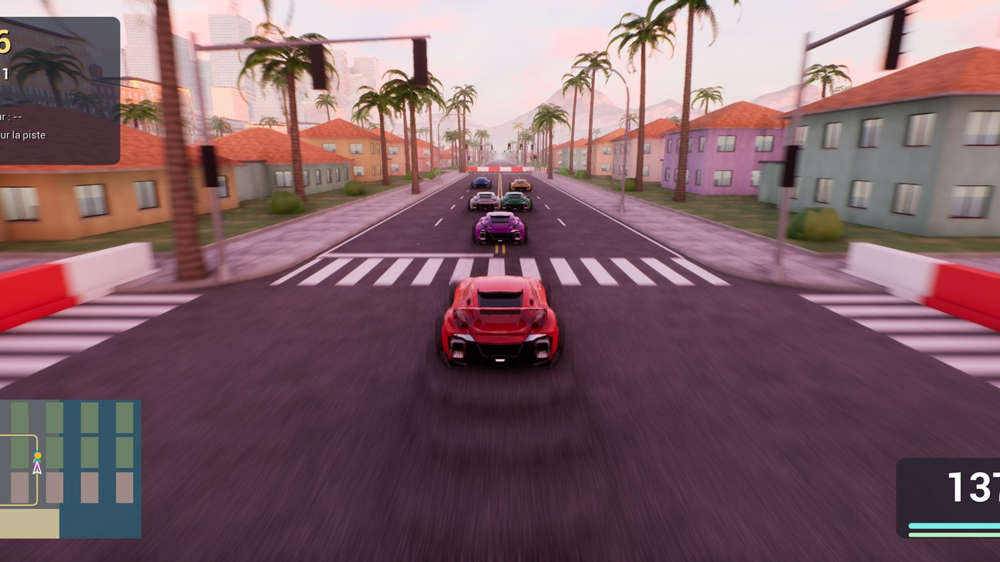
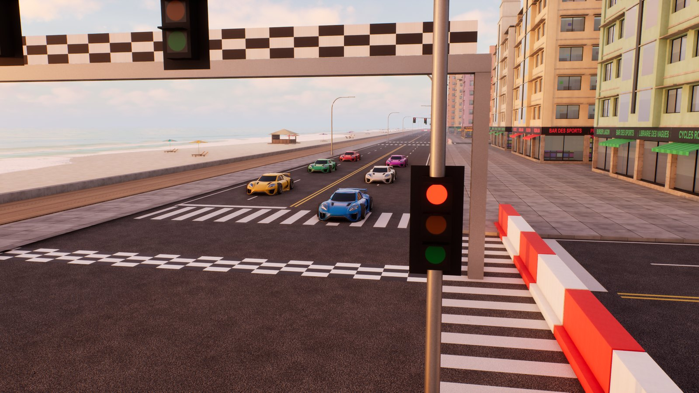
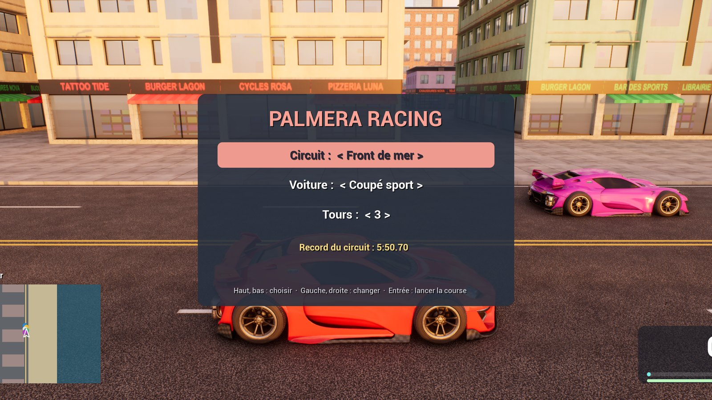

# Palmera Racing

Un jeu de course dans les rues de Palmera Bay, fait avec **Unreal Engine 5.8**. Il reprend les graphismes du jeu en monde ouvert [Palmera Bay](https://github.com/Minecraft-2048/palmera-bay) : 4 circuits fermés par des barrières, 5 pilotes à battre et un record à améliorer sur chaque circuit.

## Jouer

1. Va dans les [versions publiées](https://github.com/Minecraft-2048/palmera-racing/releases/latest) et télécharge `PalmeraRacing-Windows.zip`.
2. Décompresse le dossier, puis lance `Palmera Racing.exe`.

Il faut Windows 10 ou 11 et une carte graphique avec le lancer de rayons (testé sur une RTX 4070 portable). Le premier lancement est plus lent, le temps de préparer les shaders. Les fichiers ne sont pas signés, Windows peut donc demander une confirmation la première fois.

Le dossier contient aussi `PalmeraBay.exe`, le jeu complet en monde ouvert avec son histoire, dont Palmera Racing reprend la ville et les voitures.

## Les circuits

| Circuit | Ambiance | Longueur | Tours |
|---|---|---|---|
| Front de mer | coucher de soleil le long de la plage | 2,4 km | 3 |
| Centre-ville de nuit | entre les tours éclairées | 2,6 km | 3 |
| Tour des quartiers | en plein jour, du centre-ville aux villas | 5,2 km | 2 |
| Orage sur le port | sous la pluie, route glissante | 1,9 km | 3 |

Au menu, tu choisis le circuit, ta voiture (coupé sport, tout-terrain, berline, citadine ou SUV) et le nombre de tours, de 1 à 9. Tes adversaires s'appellent Léa Marin, Max Turbo, Zoé Rallye, Noé Piste et Ana Drift. Le record n'est gardé que pour le nombre de tours prévu par le circuit.

## Commandes

| Touche | Action |
|---|---|
| Z Q S D ou flèches | accélérer, freiner, tourner |
| Espace | frein à main, pour déraper |
| Souris | regarder autour de la voiture |
| V | replacer la caméra derrière la voiture |
| R | revenir sur la piste après une sortie de route |
| Haut, bas, gauche, droite | régler la course dans le menu |
| Entrée | lancer la course, revenir au menu à l'arrivée |
| Échap | pause, graphismes, quitter |

La manette sert aussi à conduire. Le menu, lui, se règle au clavier.

## Comment c'est fait

Palmera Racing est le même programme que Palmera Bay, lancé en mode course : la ville, les voitures, leur physique et l'interface viennent du dépôt [palmera-bay](https://github.com/Minecraft-2048/palmera-bay), qui contient tout le projet. Ce dépôt-ci garde la version jouable et les fichiers propres au jeu de course.

| Fichier | Rôle |
|---|---|
| `Source/PalmeraCourse.h`, `Source/PalmeraCourse.cpp` | circuits, barrières, grille de départ, pilotes, tours, classement et records |
| `Outils/kit_course.py` | génération des barrières et du portique d'arrivée |
| `Outils/lanceur` | le petit programme `Palmera Racing.exe` et son icône |

Un circuit est une suite de carrefours de la ville. Le tracé passe par leur centre et ses virages sont arrondis. Pour chaque point, le jeu calcule la vitesse que les pneus peuvent tenir, puis remonte le tour pour savoir où freiner. Les pilotes visent un point un peu plus loin sur leur trajectoire et respectent ces vitesses, plus ou moins vite selon leur talent. Toutes les rues qui croisent le circuit sont fermées par des barrières.

## Licences

- Le code et les scripts de ce dépôt sont sous licence [MIT](LICENSE).
- Unreal® Engine, Copyright 1998-2026, Epic Games, Inc. Tous droits réservés. Unreal® est une marque d'Epic Games, Inc. La version jouable inclut les véhicules et le mannequin de démonstration d'Epic, selon la licence d'Unreal Engine.
- Les personnages du jeu complet sont créés avec [MakeHuman](http://www.makehumancommunity.org/) et son pack d'assets libres CC0. Ses voix sont synthétisées avec les voix françaises de Windows.
